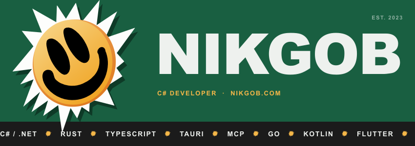
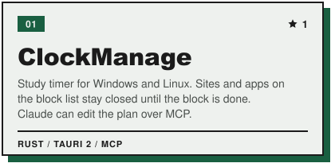
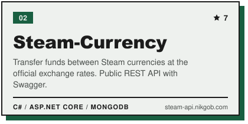
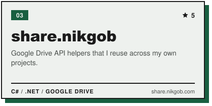
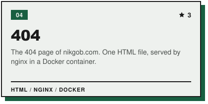
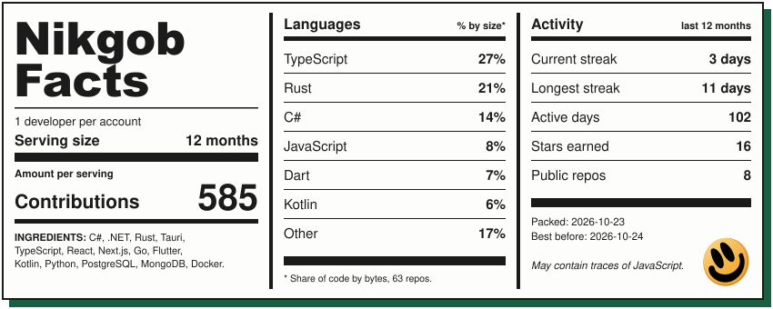

Hi, I'm NikGob. C# developer, also writing Rust and TypeScript.

These days it's mostly [ClockManage](https://github.com/NikGob/ClockManage), a study timer for Windows and Linux that keeps Telegram, Discord and Shorts closed until the block is done. Claude can manage it over MCP.

More at [nikgob.com](https://nikgob.com).

  
  
  
  

